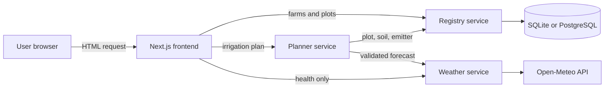

# AgroPilot - irrigation planning for growers

AgroPilot is a full-stack irrigation-planning system for agricultural plots.
It combines farm and plot records, validated weather forecasts, deterministic
FAO-56-based calculations, and a server-rendered web interface that places
today's irrigation recommendation first.

The repository demonstrates a complete engineering workflow: service
boundaries, database portability, reproducible environments, automated tests,
line and branch coverage, dependency auditing, browser acceptance tests,
performance measurements, short-lived branches, pull requests, and GitHub
Actions.

> **Project status:** the application and its automated checks are complete.
> There is no public production deployment. Run the system locally and open
> <http://localhost:3000>.

## Table of contents

- [Project goals](#project-goals)
- [What the user sees](#what-the-user-sees)
- [Architecture](#architecture)
- [Request and data flow](#request-and-data-flow)
- [Services](#services)
- [Irrigation model](#irrigation-model)
- [Repository structure](#repository-structure)
- [Prerequisites](#prerequisites)
- [Quick start](#quick-start)
- [Configuration](#configuration)
- [API overview](#api-overview)
- [Development commands](#development-commands)
- [Testing strategy](#testing-strategy)
- [Continuous integration](#continuous-integration)
- [Security and reliability](#security-and-reliability)
- [Performance evidence](#performance-evidence)
- [Git and pull-request workflow](#git-and-pull-request-workflow)
- [Codex project guidance](#codex-project-guidance)
- [Tutorial completion map](#tutorial-completion-map)
- [Implementation history](#implementation-history)
- [Troubleshooting](#troubleshooting)
- [Known limitations](#known-limitations)
- [Evidence and further reading](#evidence-and-further-reading)

## Project goals

AgroPilot has four primary goals:

1. **Keep agricultural data consistent.** Farms, plots, crops, soils, and
   irrigation emitters are maintained by one Registry service.
2. **Treat external weather as untrusted input.** Forecast data is validated,
   cached, retried, and explicitly marked stale when a safe fallback is used.
3. **Make irrigation advice explainable.** The Planner uses deterministic
   equations and documented product policies, not an opaque model.
4. **Fail safely.** Missing, invalid, old, or contradictory data produces a
   visible error instead of an invented zero recommendation.

This is an educational system, not an autonomous irrigation controller. It
does not open valves, read soil sensors, or keep a real irrigation history.

## What the user sees

The web interface provides:

- a home page containing farms and their plots;
- a plot page with today's recommendation above the fold;
- litres and runtime when irrigation is needed;
- a seven-day table of weather demand, crop coefficient, and remaining soil
  water;
- visible stale-data labels;
- clear messages when Registry, Weather, or Planner is unavailable; and
- independent service-health information.

The frontend is responsive at a 375 x 667 mobile viewport and avoids horizontal
overflow. Internal service URLs and arbitrary backend error details are never
sent to the browser.

## Architecture

The application is split into four independently run services:

| Service | Technology | Default port | Responsibility |
| --- | --- | ---: | --- |
| Registry | FastAPI, SQLAlchemy, SQLite/PostgreSQL | 8000 | Farms, plots, catalogs, validation, and persistence |
| Weather | FastAPI, HTTPX, Open-Meteo | 8001 | Forecast validation, retries, cache, and stale fallback |
| Planner | FastAPI, HTTPX | 8002 | Deterministic seven-day irrigation projection |
| Frontend | Next.js, React, TypeScript, Tailwind CSS | 3000 | Server-rendered pages and safe user-facing states |



The service boundary is HTTP. Services do not import one another's Python
modules and do not share database connections. Each service validates its own
configuration and the data received at its boundary.

### Why the frontend calls services on the server

Next.js server components fetch Registry and Planner data before sending the
finished page to the browser. This design:

- keeps internal service URLs private;
- avoids browser CORS configuration;
- centralizes timeouts and response validation;
- prevents the browser from silently constructing advice from partial data;
- fits the UI tutorial's client/server model: the browser draws the result,
  while the Next.js server talks to internal APIs.

## Request and data flow

When a grower opens a plot page:

1. The browser requests `/plots/{plot_id}` from Next.js.
2. The frontend requests plot metadata from Registry.
3. In parallel, it asks Planner for seven forecast days.
4. Planner requests the plot, its soil, and its emitter from Registry.
5. Planner requests a forecast for the plot coordinates from Weather.
6. Weather returns a fresh cache entry or calls Open-Meteo.
7. Planner validates identities, dates, coordinates, and numeric ranges.
8. Planner performs the deterministic soil-bucket projection.
9. The frontend validates the complete plan again with Zod.
10. Next.js renders today's recommendation, the weekly table, and health
    information into the response.

If any required value is unavailable, the chain returns an explicit failure.
No layer substitutes invented weather or an irrigation amount of zero.

## Services

### Registry service

Registry is the source of truth for farms, plots, crops, soils, and emitters.
It uses SQLAlchemy and a required `DATABASE_URL`. The same application supports
SQLite for local development and PostgreSQL for deployment and CI. SQL is
parameterized, transactions protect writes, and the public HTTP contract is
the same for both database engines.

The safe seed command creates the assignment's fixed dataset only in an empty
schema. It refuses to overwrite an existing schema, preserving the original
15 seeded rows and their stable IDs.

Registry errors use a stable RFC 9457-style problem response with status,
detail, instance, and code. Expected codes include `VALIDATION`, `NOT_FOUND`,
`CONFLICT`, and `UNAVAILABLE`.

Service guide: [Registry README](services/registry-service/README.md).

### Weather service

Weather adapts Open-Meteo's daily forecast to the small contract Planner needs:
calendar date, reference evapotranspiration (`ET0`), rainfall, fetch time, and
stale status.

Important behavior:

- coordinates are grouped into a 0.1-degree grid by flooring latitude and
  longitude;
- a full seven-day forecast is cached and shorter requests return a prefix;
- cache entries are fresh for three hours by default;
- the provider is retried twice after the first attempt;
- stale data may be returned for at most 24 hours, and only when it still
  covers every requested date;
- dates, lengths, units, finite numbers, and nonnegative values are validated;
- no safe cache means `503` with `Retry-After`.

Service guide: [Weather README](services/weather-service/README.md).

### Planner service

Planner combines Registry and Weather data. It owns all irrigation arithmetic
and returns date, `ET0`, crop coefficient `Kc`, litres, emitter runtime,
stale status, and projected end-of-day soil water.

It rejects unknown crops, future planting dates, mismatched plot IDs,
mismatched coordinates, gaps in forecast dates, non-finite values, and
upstream failures. Planner does not retry Registry or Weather itself; each
upstream call has a bounded timeout.

Service guide: [Planner README](services/planner-service/README.md).

### Frontend

The frontend uses the Next.js App Router, React, TypeScript, Tailwind CSS 4,
Zod validation, and locally owned shadcn-style Badge and Alert components.

The repository follows the UI tutorial's conventions:

- `package.json` defines dependencies and scripts;
- `package-lock.json` pins exact dependency versions and is committed;
- `node_modules/` and `.next/` are generated and ignored;
- `.env.example` documents settings, while `.env.local` remains private;
- `.ts` contains TypeScript utilities and `.tsx` contains React pages and
  components;
- folders under `src/app/` map to routes;
- `npm run dev`, `build`, `start`, and `lint` have distinct roles;
- both build and lint run before work is considered complete.

The current pages are server components because they do not need browser
state. Browser-side `"use client"` components should be introduced only for
real interactions that require state or event handlers.

Service guide: [Frontend README](services/frontend/README.md).

## Irrigation model

The calculation is based on FAO-56 concepts with explicit AgroPilot policies.
The source research and product choices are kept separate so the result remains
auditable.

### Crop demand

```text
ETc = ET0 x Kc
```

`Kc` follows the selected tomato or bell-pepper growth stages. It is constant
in the initial and middle stages, interpolated during development and late
season, and clamped at the final value after the documented stage duration.

### Soil bucket

```text
capacity_mm = available_water_mm_per_m x root_depth_m
projected_mm = min(capacity_mm, previous_mm + rain_mm - ETc_mm)
```

Every request starts with a full bucket. If projected water falls below half
the capacity, the plan refills the bucket to capacity on that day. Exactly half
does not trigger irrigation.

This full-bucket start is a simulation assumption, not measured soil moisture.
Water carries across the seven forecast days only and is not written to a
database.

### Volume and runtime

```text
litres = irrigation_depth_mm x plot_area_m2
emitter_count = plot_area_m2 / (row_spacing_m x emitter_spacing_m)
runtime_minutes = ceil(litres / emitter_count / flow_lph x 60)
```

The planner uses exact rational arithmetic for the final runtime conversion so
binary floating-point noise does not add an extra minute at an integer boundary.

See the [FAO-56 research](services/planner-service/docs/research/fao56.md) and
[verification note](services/planner-service/docs/research/fao56-verification.md)
for equations, citations, hand calculations, and simplifications.

## Repository structure

```text
ArgoPilot/
├── .agents/skills/                  # reusable Codex project skills
├── .github/workflows/
│   ├── registry-tests.yml           # registry tests, coverage, audit
│   └── p2-services.yml              # weather, planner, PostgreSQL, frontend
├── docs/                            # design, evidence, benchmarks, walkthrough
├── services/
│   ├── registry-service/
│   ├── weather-service/
│   ├── planner-service/
│   └── frontend/
├── dev.sh                           # start / stop all services locally
├── AGENTS.md                        # repository instructions for Codex
└── README.md
```

Each Python service owns its `pyproject.toml`, `uv.lock`, tests, and example
configuration. The frontend owns its Node dependencies and lockfile.

## Prerequisites

- Git
- Python 3.12 or 3.13
- [uv](https://docs.astral.sh/uv/)
- Node.js 22 LTS or newer
- npm
- SQLite for the default local setup
- Chromium installed through Playwright for browser tests
- PostgreSQL 15 only when reproducing the PostgreSQL contract test

## Quick start

```bash
git clone https://github.com/Alon-ds/ArgoPilot.git
cd ArgoPilot
```

### One-command start (recommended)

`dev.sh` starts all four services in the background, waits for each to pass its
health check, and prints the URLs.

**First-time setup** — run once before the first `dev.sh`:

```bash
# Registry — install deps and seed the database
cd services/registry-service && uv sync --locked && cp .env.example .env
uv run python -m seed && cd ../..

# Weather
cd services/weather-service && uv sync --locked && cp .env.example .env && cd ../..

# Planner
cd services/planner-service && uv sync --locked && cp .env.example .env && cd ../..

# Frontend
cd services/frontend && npm ci && cp .env.example .env.local && cd ../..
```

> Seed only an empty Registry database. The seed command intentionally refuses
> to replace existing data.

**Start all services:**

```bash
./dev.sh
```

**Stop all services:**

```bash
./dev.sh stop
```

Logs are written to `tmp/logs/` (one file per service).

Open <http://localhost:3000>. Health endpoints are available at `/health` on
each Python service; FastAPI documentation at `/docs`.

### Manual start (one terminal per service)

If you prefer to watch each service's output directly:

**Terminal 1 — Registry**

```bash
cd services/registry-service
uv run uvicorn main:app --host 127.0.0.1 --port 18000
```

**Terminal 2 — Weather**

```bash
cd services/weather-service
uv run uvicorn main:app --host 127.0.0.1 --port 18001
```

**Terminal 3 — Planner**

```bash
cd services/planner-service
uv run uvicorn main:app --factory --host 127.0.0.1 --port 18002
```

**Terminal 4 — Frontend**

```bash
cd services/frontend
npm run dev
```

## Configuration

Never commit real `.env` or `.env.local` files. Codex instructions explicitly
forbid reading or committing them; use the examples below as the contract.

### Registry

| Variable | Required | Default/example | Purpose |
| --- | --- | --- | --- |
| `DATABASE_URL` | Yes | `sqlite:///registry.db` | SQLAlchemy SQLite or PostgreSQL URL |

### Weather

| Variable | Required | Default | Purpose |
| --- | --- | --- | --- |
| `OPEN_METEO_BASE_URL` | No | `https://api.open-meteo.com` | Provider origin |
| `OPEN_METEO_API_KEY` | No | empty | Customer API key when needed |
| `FORECAST_TIMEZONE` | No | `Asia/Jerusalem` | Calendar-day boundary |
| `PROVIDER_TIMEOUT_SECONDS` | No | `5` | Provider timeout |
| `PROVIDER_RETRIES` | No | `2` | Retries after the first attempt |
| `CACHE_FRESHNESS_SECONDS` | No | `10800` | Three-hour fresh period |
| `STALE_MAX_AGE_SECONDS` | No | `86400` | Maximum total cache age |
| `RETRY_AFTER_SECONDS` | No | `60` | Client retry guidance on 503 |

### Planner

| Variable | Required | Default/example | Purpose |
| --- | --- | --- | --- |
| `REGISTRY_URL` | Yes | `http://127.0.0.1:8000` | Registry base URL |
| `WEATHER_URL` | Yes | `http://127.0.0.1:8001` | Weather base URL |
| `UPSTREAM_TIMEOUT_SECONDS` | No | `5` | Per-upstream timeout |
| `PLANNER_TIMEZONE` | No | `Asia/Jerusalem` | Definition of today |

### Frontend

| Variable | Required | Default/example | Purpose |
| --- | --- | --- | --- |
| `REGISTRY_URL` | Yes | `http://127.0.0.1:8000` | Server-side Registry URL |
| `WEATHER_URL` | Yes | `http://127.0.0.1:8001` | Server-side health URL |
| `PLANNER_URL` | Yes | `http://127.0.0.1:8002` | Server-side Planner URL |
| `SERVICE_TIMEOUT_MS` | No | `5000` | 100-60000 ms request timeout |
| `PLAN_TIMEZONE` | No | `Asia/Jerusalem` | Must agree with Planner |

## API overview

### Registry

| Method | Path | Purpose |
| --- | --- | --- |
| `GET` | `/health` | Liveness |
| `POST/GET` | `/v1/farms` | Create or list farms |
| `GET/PATCH/DELETE` | `/v1/farms/{id}` | Farm lifecycle |
| `POST/GET` | `/v1/plots` | Create or list plots; list supports `farm_id` |
| `GET/PATCH/DELETE` | `/v1/plots/{id}` | Plot lifecycle |
| `GET` | `/v1/plots/{id}/area` | Square metres and dunams |
| `GET` | `/v1/crops[/id]` | Crop catalog |
| `GET` | `/v1/soils[/id]` | Soil catalog |
| `GET` | `/v1/emitters[/id]` | Emitter catalog |

Plot-area example:

```json
{
  "plot_id": "c8f3d1b0-4d2e-5a1b-8b22-1d6e3f702002",
  "area_m2": 1000,
  "area_dunam": 1.0
}
```

The conversion is `area_m2 / 1000`. Unknown plots return `404 NOT_FOUND`.

### Weather

```http
GET /v1/forecast?lat=31.25&lon=34.79&days=7
```

`days` accepts 1-7. Invalid coordinates or days return `422`; an unavailable
provider without a safe cache returns `503`.

### Planner

```http
GET /v1/plots/{plot_uuid}/plan?days=7
```

`days` accepts 1-7. An unknown plot returns `404`; invalid upstream data
returns a service-specific `503`.

## Development commands

### Registry

```bash
cd services/registry-service
uv sync --locked
uv run python -m pytest --cov --cov-report=term --cov-report=html
uv audit --locked --preview-features audit-command
```

### Weather

```bash
cd services/weather-service
uv sync --locked
uv run python -m pytest
uv run ruff check .
uv audit --locked --preview-features audit-command
```

### Planner

```bash
cd services/planner-service
uv sync --locked
uv run python -m pytest
uv run ruff check .
uv audit --locked --preview-features audit-command
```

### Frontend

```bash
cd services/frontend
npm ci
npm run lint
npm run build
npm audit --audit-level=low
npm exec -- playwright install chromium
npm test
```

`npm run dev` is optimized for development and rebuilds after edits.
`npm run build` performs a production build and can catch problems that the
development server does not. `npm run start` serves that production build.

## Testing strategy

- **Registry integration tests** exercise real HTTP routes, database
  transactions, validation, errors, and the plot-area conversion.
- **PostgreSQL contract tests** prove that the same Registry and seed behavior
  works against PostgreSQL, not only SQLite.
- **Weather tests** use controlled provider responses for validation, cache,
  retries, stale fallback, calendar dates, and failure states.
- **Planner tests** use hand-calculated examples and invalid-upstream cases to
  verify crop curves, bucket thresholds, rain, volume, and runtime.
- **Frontend Playwright tests** run the production server against controlled
  HTTP fixtures and verify pages, errors, stale data, health, mobile layout,
  and that the browser never calls internal services directly.

Observed verification from the completed implementation:

| Area | Result |
| --- | --- |
| Registry | 17 tests; 100% line and branch coverage on Python 3.12 and 3.13 |
| PostgreSQL | 15 seed rows; live read and transaction contract passed |
| Weather | 59 tests; real Open-Meteo integration checked |
| Planner | 67 tests |
| Frontend | lint, production build, and 13 Playwright tests passed |
| Mobile | 375 px advice visibility and no horizontal overflow |
| Dependencies | all Python `uv audit` checks and `npm audit` passed |

These are recorded observations, not promises that future commits remain green.
GitHub Actions reruns the checks on every pull request.

## Continuous integration

Two workflow files live under `.github/workflows/`.

### Registry workflow

`registry-tests.yml` runs:

1. checkout on a clean Ubuntu runner;
2. Python 3.12 and 3.13 matrix jobs;
3. locked dependency installation;
4. pytest with terminal and HTML coverage;
5. HTML coverage artifact upload, even on failure; and
6. a parallel dependency-audit job.

Registry coverage uses branch measurement and `fail_under = 100`. A passing
test suite still fails CI if coverage drops below 100%.

### P2 services workflow

`p2-services.yml` runs independent jobs for:

- Weather tests and audit;
- Planner tests and audit;
- PostgreSQL 15 service container, safe seed, and contract test;
- frontend locked install, lint, production build, npm audit, Chromium install,
  and Playwright tests;
- browser-result artifact upload with `if: always()`.

Independent jobs run in parallel. Every runner starts clean: it has no local
`.venv`, `.env`, `.env.local`, database, `.next/`, or `node_modules/`.
This is why lockfiles, example configuration, and explicit setup steps matter.

The setup action is pinned to the real release
`astral-sh/setup-uv@v10.4.0`. A floating `@v10` reference once failed because
that tag did not exist; pinning the published version fixed the workflow.

Actions dashboard: <https://github.com/Alon-ds/ArgoPilot/actions>.

## Security and reliability

- Lockfiles make local and CI dependency resolution reproducible.
- `uv audit --locked --preview-features audit-command` checks Python lockfiles
  against known vulnerability data.
- `npm audit --audit-level=low` checks frontend dependencies.
- Passing audits mean no listed vulnerability was found at scan time; they do
  not prove that every dependency is safe.
- Real environment files are ignored and Codex is instructed not to read or
  commit them.
- GitHub workflows use read-only repository contents permission.
- Checkout credentials are not persisted where unnecessary.
- Server-only frontend modules prevent internal API clients from entering the
  browser bundle.
- Zod and Pydantic validate configuration before serving normal requests.
- All services bound external calls with timeouts.
- Weather retries and stale fallback are constrained by age and date coverage.
- Planner and frontend reject incomplete plans instead of displaying unsafe
  recommendations.

## Performance evidence

- Registry with PostgreSQL: 300 requests over 30 seconds at 10 total requests
  per second, zero errors, highest route p95 23.332 ms.
- Weather warm cache: p95 7.555 ms at 10 requests per second with zero provider
  calls during measurement.
- Real-provider-backed Weather cache: p95 6.385 ms.

These are controlled development observations, not production service-level
guarantees. See [the PostgreSQL benchmark data](docs/p2-postgresql-benchmark.json)
and each service's benchmark script for reproduction details.

## Git and pull-request workflow

The project follows the CI tutorial's production rule:

```text
main -> short-lived feature branch -> pull request -> checks/review -> merge
```

Completed examples:

- [PR #6](https://github.com/Alon-ds/ArgoPilot/pull/6) added plot-area behavior,
  tests, coverage enforcement, and CI.
- [PR #8](https://github.com/Alon-ds/ArgoPilot/pull/8) delivered the complete P2
  architecture, services, frontend, tests, audits, and evidence.
- [PR #9](https://github.com/Alon-ds/ArgoPilot/pull/9) restored verification
  documentation.
- [PR #10](https://github.com/Alon-ds/ArgoPilot/pull/10) expanded the project
  overview and local-run instructions.

The intended ruleset includes pull requests, required checks, deletion
restriction, and force-push blocking. GitHub reported that enforcement is not
available for this private repository on the current account plan. The ruleset
configuration and green checks should therefore not be described as enforced
branch protection.

## Codex project guidance

The project uses Codex-native repository instructions:

- [AGENTS.md](AGENTS.md) defines safety, configuration, verification, and
  branch expectations.
- `.agents/skills/registry-api` documents Registry HTTP conventions.
- `.agents/skills/irrigation-calc-reference` preserves calculation policy and
  hand-worked examples.
- `.agents/skills/frontend-design` guides UI design and critique.
- `.agents/skills/research` requires high-trust primary sources.

These replace the previous Claude-specific `.claude` location. The application
itself has no runtime dependency on an AI agent.

## Tutorial completion map

### GitHub Actions tutorial

| Tutorial requirement | AgroPilot implementation |
| --- | --- |
| Workflow under `.github/workflows/` | Two workflows are committed |
| Run tests from the service directory | `defaults.run.working-directory` |
| Locked installs | `uv sync --locked`, `npm ci` |
| Plot-area endpoint | `GET /v1/plots/{id}/area` |
| Actual numeric and 404 tests | Registry integration suite |
| Short-lived branch and PR | PR #6 and later PRs |
| Python coverage | pytest-cov, line and branch measurement |
| 100% gate | `fail_under = 100` in Registry |
| HTML coverage | Generated in CI |
| Coverage artifacts | Uploaded for both Python matrix versions |
| Local dependency audit | Completed for every Python service |
| Audit CI job | Registry audit plus Weather/Planner audits |
| Required checks | Configured intent; not enforceable on current private plan |

### Intro to UI tutorial

| Tutorial concept | AgroPilot implementation |
| --- | --- |
| Browser/client versus server | Browser receives rendered pages; Next server calls APIs |
| HTML, CSS, JavaScript | TSX structure, global Tailwind CSS, compiled JavaScript |
| Node.js and TypeScript | Next.js 16, React 19, TypeScript 5 |
| npm and package metadata | `package.json` and committed `package-lock.json` |
| Generated folders ignored | `node_modules/` and `.next/` |
| Environment separation | committed `.env.example`, private `.env.local` |
| Route folders | `src/app/page.tsx`, `src/app/plots/[id]/page.tsx` |
| Reusable components | plan, health, service-error, Badge, and Alert components |
| Build and lint verification | both run locally and in GitHub Actions |
| Client state only when needed | current read-only pages stay server components |
| Production browser tests | Playwright runs against `npm run start` |

## Implementation history

1. **Registry foundation.** Farms, plots, catalogs, validation, transactions,
   stable errors, seed data, and initial integration tests were established.
2. **Plot-area feature.** `area_m2 / 1000` was exposed as dunams, with success
   and missing-plot tests.
3. **First CI workflow.** GitHub Actions reproduced dependency installation and
   test execution on clean runners.
4. **Coverage gate.** pytest-cov measured lines and branches, missing paths
   received tests, `fail_under = 100` became a gate, and HTML reports became
   artifacts.
5. **Dependency security.** `uv audit` ran locally and in a parallel CI job.
6. **Database portability.** Registry moved to SQLAlchemy, retained SQLite for
   development, added PostgreSQL support, and gained a safe seed contract.
7. **Weather boundary.** Open-Meteo data gained strict validation, grid caching,
   retries, stale fallback, and explicit 503 behavior.
8. **FAO-56 research.** Primary-source equations and product decisions were
   documented before Planner arithmetic was finalized.
9. **Deterministic Planner.** Crop stages, soil bucket, irrigation volume, and
   emitter runtime were implemented with hand-calculated tests.
10. **Next.js frontend.** Server-rendered farm and plot pages displayed today's
    recommendation, seven days, stale state, health, and failures.
11. **Browser acceptance.** Playwright verified normal and error paths, mobile
    layout, and the absence of browser-to-backend calls.
12. **P2 CI.** Weather, Planner, PostgreSQL, frontend build/lint/audit, and
    browser tests became automated jobs and artifacts.
13. **Performance verification.** Registry/PostgreSQL and Weather cache
    benchmarks stayed below the assignment's 100 ms p95 target.
14. **Workflow repair.** The nonexistent `setup-uv@v10` tag was replaced by
    `setup-uv@v10.4.0`; fresh runs passed.
15. **Documentation and Codex adaptation.** Evidence, setup instructions, and
    reusable agent guidance were aligned.

## Troubleshooting

### Frontend says Planner returned HTTP 500 or is unavailable

```bash
curl http://127.0.0.1:8000/health
curl http://127.0.0.1:8001/health
curl http://127.0.0.1:8002/health
```

Confirm that Planner's `REGISTRY_URL` and `WEATHER_URL` match the actual
ports. Restart a stale Planner process after changing environment values.

### Port already in use

```bash
lsof -nP -iTCP:8002 -sTCP:LISTEN
```

Inspect the process before stopping it. Stop only the known development service
or select a new port and update every dependent URL.

### Frontend configuration is invalid

Create `services/frontend/.env.local` from `.env.example`. All three service
URLs must be valid HTTP(S) URLs, and `PLAN_TIMEZONE` must be an installed IANA
time zone matching Planner.

### Registry seed refuses to run

The target database is not empty. This is intentional. Use a new development
database instead of overwriting existing records.

### Weather returns 503

Open-Meteo failed and no valid cache entry exists. Check connectivity and the
provider settings. Respect the `Retry-After` response.

### CI cannot resolve `astral-sh/setup-uv@v10`

Use the published version already pinned by this repository:
`astral-sh/setup-uv@v10.4.0`.

### Development works but CI fails

Run production-oriented commands, not only development servers:

```bash
uv sync --locked
npm ci
npm run lint
npm run build
npm test
```

Clean runners expose missing lockfile updates, ignored local files, and missing
environment variables.

## Known limitations

- No public production URL or deployment configuration is included.
- The planner starts every request with a full soil bucket.
- No soil sensor data or irrigation history is stored.
- The irrigation model uses fixed root depths and simplified product policies.
- Weather cache is in-process and not shared across service replicas.
- Frontend pages are read-only for the P2 scope.
- A passing dependency audit covers known published vulnerabilities only.
- Branch rules cannot be enforced for this private repository on the current
  GitHub plan.
- Benchmarks are controlled local observations, not production guarantees.

## Evidence and further reading

- [P2 design](docs/p2-design.md)
- [P2 implementation plan](docs/p2-plan.md)
- [Verification evidence](docs/p2-verification.md)
- [Hebrew walkthrough](docs/p2-walkthrough-he.md)
- [Registry benchmark](docs/registry-benchmark.md)
- [PostgreSQL benchmark data](docs/p2-postgresql-benchmark.json)
- [Registry service guide](services/registry-service/README.md)
- [Weather service guide](services/weather-service/README.md)
- [Planner service guide](services/planner-service/README.md)
- [Frontend service guide](services/frontend/README.md)
- [GitHub Actions tutorial](https://github.com/alonitac/OzVeruach26/blob/main/tutorials/github_actions_intro.md)
- [Intro to UI tutorial](https://github.com/alonitac/OzVeruach26/blob/main/tutorials/intro_to_ui.md)
